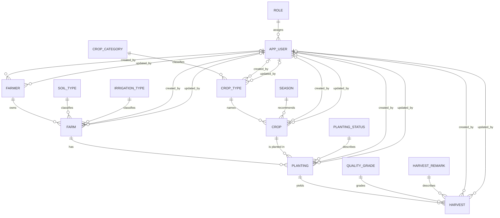

# Agriculture Information System

The Agriculture Information System is a PHP 8 web application connected to a Supabase PostgreSQL database. It helps users manage farmers, farms, crop varieties, plantings, harvests, and user accounts. The system has Administrator and Staff roles, a dashboard, and reports.

## 1. Project Title and Description

This student project provides a central place to maintain agriculture records. Farmers can be linked to their farms, plantings connect a farm with a crop, and harvest records belong to plantings. Lookup tables hold shared descriptions such as soil types and planting statuses. Users sign in with an account assigned to a role.

## 2. Project Objectives

1. Keep farmer, farm, crop, planting, and harvest records in a relational database.
2. Organize the records with primary keys, foreign keys, lookup tables, and validation rules.
3. Allow signed-in users to work with records according to their role.
4. Provide a dashboard and reports to summarize the stored records.
5. Document the database design and explain how to use the application.

## 3. Functional Requirements

1. **Sign in and sign out.** Users sign in with a username and password. Inactive users and incorrect credentials are rejected. After five failed attempts, another attempt is delayed for 60 seconds. Users can log out.
2. **Apply role permissions.** Administrators can use the user-account module and delete records. Staff can access the application’s normal modules, but cannot delete records or manage user accounts.
3. **Manage farmers.** Signed-in users can list, search, view, add, and edit farmers. The list can be filtered by address and sorted by its displayed sortable columns. Contact numbers must follow the Philippine mobile-number pattern and must be unique.
4. **Manage farms.** Signed-in users can list, search, view, add, and edit farms. A farm is assigned to a farmer and has a location, area, soil type, and irrigation type. The list supports soil and irrigation filters and sortable columns. A farmer cannot have two farms with the same name; planted area is considered when reducing a farm’s area.
5. **Manage crops.** Signed-in users can list, search, view, add, and edit crops. A crop has a crop name, category, variety, growing period, and season. The crop name and category are entered in the Crops form; a separate crop-type page is not provided. A crop name has one category, and each crop-name/variety pair must be unique. Crop lists can be filtered by category and season.
6. **Manage plantings.** Signed-in users can list, search, view, add, and edit planting records. A planting identifies a farm, crop, planting date, planted area, seed quantity, expected harvest date, and status. The list supports status, farm, crop, and planting-date filters. The expected harvest date cannot precede the planting date, and planted area cannot exceed the farm’s area. The form suggests an expected harvest date using the selected crop’s growing period.
7. **Manage harvests.** Signed-in users can list, search, view, add, and edit harvest records. A harvest identifies a planting, harvest date, quantity, selling price per kilogram, quality grade, and remark. The list supports crop, grade, remark, and harvest-date filters. A harvest cannot predate its planting. The form displays an estimated value calculated from quantity and price.
8. **Manage user accounts.** Administrators can list, search, add, and edit accounts; assign a role; activate or deactivate an account; and set or change its password. Accounts are not deleted through this module. The current Administrator cannot deactivate their own account or remove their own Administrator role.
9. **Search and browse records.** Module lists provide the search, filters, and sortable headings implemented for that module. Lists are paginated, with 10 records per page.
10. **Read the dashboard.** The dashboard shows counts of farmers, farms, crops, plantings, and harvests; total harvested quantity and estimated value; plantings by status; up to eight crops by harvested quantity; and the five most recent plantings and harvests.
11. **Run reports.** The Reports module provides Farmers and Their Farms, Crops Planted per Farm, Planting Records by Status, Harvest Records, Total Harvested Quantity, and Estimated Harvest Value. Available filters vary by report. Reports can be printed or exported as CSV.
12. **Protect referenced records.** Database foreign keys prevent deletion of a record that is still referenced. The module delete actions are Administrator-only and require a POST request.

## 4. Entity-Relationship Diagram



The Mermaid source is also available in [erd.mmd](erd.mmd).
The Mermaid diagram in `erd.mmd` is the current ERD. The older `erd.png` does not show the `crop_type` split: `crop_type` stores `crop_name` and `category_id`, while `crop` stores `crop_type_id`, `variety`, `growing_period_days`, and `season_id`.

Each relationship below is one-to-many (1:M): a parent row can be referenced by zero or many child rows; each child row has exactly one parent unless noted. The “many” side may be empty.

| Parent (one) | Child (many) | Meaning and cardinality |
|---|---|---|
| farmer | farm | One farmer can own zero or many farms; each farm has one farmer. |
| soil_type | farm | One soil type can classify zero or many farms; each farm has one soil type. |
| irrigation_type | farm | One irrigation type can classify zero or many farms; each farm has one irrigation type. |
| farm | planting | One farm can have zero or many planting records; each planting references one farm. |
| crop_category | crop_type | One category can classify zero or many crop types; each crop type has one category. |
| crop_type | crop | One crop type can have zero or many crop varieties; each crop has one crop type. |
| season | crop | One season can be recommended for zero or many crops; each crop has one season. |
| crop | planting | One crop can be used in zero or many plantings; each planting references one crop. |
| planting_status | planting | One status can describe zero or many plantings; each planting has one status. |
| planting | harvest | One planting can have zero or many harvests; each harvest references one planting. |
| quality_grade | harvest | One quality grade can apply to zero or many harvests; each harvest has one grade. |
| harvest_remark | harvest | One remark can describe zero or many harvests; each harvest has one remark. |
| role | app_user | One role can be assigned to zero or many users; each user has one role. |
| app_user | farmer, farm, crop_type, crop, planting, harvest (created_by) | One user can be recorded as creator of zero or many rows. Each row has zero or one creator because `created_by` is nullable. |
| app_user | farmer, farm, crop_type, crop, planting, harvest (updated_by) | One user can be recorded as updater of zero or many rows. Each row has zero or one updater because `updated_by` is nullable. |

## 5. Normalization Process

The examples below show how a single record with nested repeating groups can be separated into the tables used by the schema.

### 5.1 Unnormalized Form (UNF)

One farmer record can contain repeated farms; each farm can contain repeated plantings; each planting can contain repeated harvests. Braces mark repeating groups. Values shown are a representative example based on the seed data.

```text
FARMER_RECORD(
  farmer_id=1, first_name="Juan", last_name="Dela Cruz",
  contact_number="09171234567", address="Cebu City", date_registered="2026-10-26",
  { farm_id=1, farm_name="Dela Cruz Farm", location="Cebu City",
    area_hectares=2.50, soil_type="Loam", irrigation_type="Rainfed",
    { planting_id=1, crop_name="Rice", category="Cereal", variety="NSIC Rc 222",
      growing_period_days=115, season="Wet Season", planting_date="2026-01-10",
      area_planted=0.50, seed_quantity=10.00, expected_harvest_date="2026-05-05",
      status="Harvested",
      { harvest_id=1, harvest_date="2026-05-05", quantity_kg=900.00,
        selling_price_per_kg=22.00, quality_grade="Grade A",
        harvest_remark="Good Harvest" } } }
)
```

This layout has repeating groups and repeats farmer, farm, crop, and lookup descriptions in a combined record. It is difficult to represent multiple related records without repeating groups and can cause inconsistent updates.

### 5.2 First Normal Form (1NF) — atomic values

Replace each repeating group with rows containing one value per field. For example, a flat view has one row for each harvest, with the related farmer, farm, planting, crop, and lookup values repeated as needed. For explaining partial dependencies in this teaching example, treat the combined farmer, farm, crop, planting, and harvest identifiers as a composite row identity; it is not a constraint in the final schema, which gives each entity its own primary key:

```text
FARMER_RECORD_1NF(
  farmer_id, first_name, last_name, contact_number, address, date_registered,
  farm_id, farm_name, location, area_hectares, soil_type_name, irrigation_type_name,
  planting_id, planting_date, area_planted, seed_quantity, expected_harvest_date,
  status_name, crop_name, category_name, variety, growing_period_days, season_name,
  harvest_id, harvest_date, quantity_kg, selling_price_per_kg,
  grade_name, remark_description
)
```

Every cell is atomic and each row represents a single harvest (or one planting when there is no harvest). A join of these rows still repeats data and is an intermediate form, not the final table design.

### 5.3 Second Normal Form (2NF) — remove partial dependencies

In the flat record, attributes such as `first_name` and `contact_number` depend on `farmer_id` alone; `farm_name` and `area_hectares` depend on `farm_id`; planting dates and quantities depend on `planting_id`; and harvest quantity and price depend on `harvest_id`. Each dependency uses only part of the combined row identity, so these attributes are repeated across joined rows.

Separate the data by the identifier that determines each record. This removes those partial dependencies and avoids storing the farmer, farm, planting, and harvest details repeatedly:

```text
FARMER(farmer_id, first_name, last_name, contact_number, address, date_registered, ...)
FARM(farm_id, farmer_id, farm_name, location, area_hectares, soil_type, irrigation_type, ...)
CROP(crop_id, crop_name, category, variety, growing_period_days, season, ...)
PLANTING(planting_id, farm_id, crop_id, planting_date, area_planted, seed_quantity,
         expected_harvest_date, status, ...)
HARVEST(harvest_id, planting_id, harvest_date, quantity_kg,
        selling_price_per_kg, quality_grade, remark, ...)
```

The ellipses stand for the audit columns present in the schema. Lookup descriptions are still shown here as names to explain the next step.

### 5.4 Third Normal Form (3NF) — remove lookup and crop-name dependencies

Move repeated descriptions into lookup tables and store their IDs in the referencing records. The crop split is important: `crop_name` and its `category` depend on the crop name, not on a particular variety. They therefore belong in `crop_type`. The `crop` table keeps `crop_type_id` plus `variety`, `growing_period_days`, and `season_id`.

```text
CROP_TYPE(crop_type_id, crop_name, category_id, created_at, updated_at, created_by, updated_by)
CROP(crop_id, crop_type_id, variety, growing_period_days, season_id,
     created_at, updated_at, created_by, updated_by)
```

The other descriptive values are stored in these lookup tables and referenced by IDs:

| Lookup table | Identifier and description |
|---|---|
| `soil_type` | `soil_type_id`, `soil_type_name` |
| `irrigation_type` | `irrigation_type_id`, `irrigation_type_name` |
| `crop_category` | `category_id`, `category_name` |
| `season` | `season_id`, `season_name` |
| `planting_status` | `status_id`, `status_name` |
| `quality_grade` | `quality_grade_id`, `grade_name` |
| `harvest_remark` | `remark_id`, `remark_description` |

Authentication is held separately in `role(role_id, role_name)` and `app_user(user_id, username, password_hash, full_name, role_id, is_active, created_at, updated_at)`. The schema also adds audit columns (`created_at`, `updated_at`, `created_by`, `updated_by`) to the six main tables. In the resulting design, each non-key attribute describes the key of its own table rather than a different entity or lookup description.

## 6. Data Dictionary

The schema creates exactly 15 tables: 6 main (`farmer`, `farm`, `crop_type`, `crop`, `planting`, `harvest`), 7 lookup (`soil_type`, `irrigation_type`, `crop_category`, `season`, `planting_status`, `quality_grade`, `harvest_remark`), and 2 login (`role`, `app_user`). The following tables and column definitions are taken from `sql/01_schema.sql`. `PK` means primary key, `FK` foreign key, `UNIQUE` unique, `NOT NULL` required, `CHECK` a database check, and `DEFAULT` a generated value. Identity columns are generated by default when an ID is not supplied.

### `soil_type`

| Column | Data type | Constraints | Description |
|---|---|---|---|
| `soil_type_id` | `SMALLINT` | PK, identity | Soil type identifier. |
| `soil_type_name` | `VARCHAR(50)` | NOT NULL, UNIQUE | Soil type description. |

### `irrigation_type`

| Column | Data type | Constraints | Description |
|---|---|---|---|
| `irrigation_type_id` | `SMALLINT` | PK, identity | Irrigation type identifier. |
| `irrigation_type_name` | `VARCHAR(50)` | NOT NULL, UNIQUE | Irrigation method description. |

### `crop_category`

| Column | Data type | Constraints | Description |
|---|---|---|---|
| `category_id` | `SMALLINT` | PK, identity | Crop category identifier. |
| `category_name` | `VARCHAR(50)` | NOT NULL, UNIQUE | Category description. |

### `season`

| Column | Data type | Constraints | Description |
|---|---|---|---|
| `season_id` | `SMALLINT` | PK, identity | Season identifier. |
| `season_name` | `VARCHAR(30)` | NOT NULL, UNIQUE | Season description. |

### `planting_status`

| Column | Data type | Constraints | Description |
|---|---|---|---|
| `status_id` | `SMALLINT` | PK, identity | Planting status identifier. |
| `status_name` | `VARCHAR(30)` | NOT NULL, UNIQUE | Status description. |

### `quality_grade`

| Column | Data type | Constraints | Description |
|---|---|---|---|
| `quality_grade_id` | `SMALLINT` | PK, identity | Harvest grade identifier. |
| `grade_name` | `VARCHAR(30)` | NOT NULL, UNIQUE | Quality grade description. |

### `harvest_remark`

| Column | Data type | Constraints | Description |
|---|---|---|---|
| `remark_id` | `SMALLINT` | PK, identity | Harvest remark identifier. |
| `remark_description` | `VARCHAR(100)` | NOT NULL, UNIQUE | Harvest remark text. |

### `role`

| Column | Data type | Constraints | Description |
|---|---|---|---|
| `role_id` | `SMALLINT` | PK, identity | Role identifier. |
| `role_name` | `VARCHAR(30)` | NOT NULL, UNIQUE | Role name, such as Administrator or Staff. |

### `app_user`

| Column | Data type | Constraints | Description |
|---|---|---|---|
| `user_id` | `INTEGER` | PK, identity | User account identifier. |
| `username` | `VARCHAR(50)` | NOT NULL, UNIQUE | Sign-in name. |
| `password_hash` | `VARCHAR(255)` | NOT NULL | Password hash. |
| `full_name` | `VARCHAR(100)` | NOT NULL | User’s displayed name. |
| `role_id` | `SMALLINT` | FK → `role.role_id`, NOT NULL, ON DELETE RESTRICT | Assigned role. |
| `is_active` | `BOOLEAN` | NOT NULL, DEFAULT `TRUE` | Whether the account is active. |
| `created_at` | `TIMESTAMPTZ` | NOT NULL, DEFAULT `now()` | Account creation time. |
| `updated_at` | `TIMESTAMPTZ` | NOT NULL, DEFAULT `now()` | Last account update time; refreshed on update by trigger. |

### `farmer`

| Column | Data type | Constraints | Description |
|---|---|---|---|
| `farmer_id` | `INTEGER` | PK, identity | Farmer identifier. |
| `first_name` | `VARCHAR(50)` | NOT NULL | Farmer’s first name. |
| `last_name` | `VARCHAR(50)` | NOT NULL | Farmer’s last name. |
| `contact_number` | `VARCHAR(20)` | NOT NULL, UNIQUE, CHECK `chk_farmer_contact` | Philippine mobile number. |
| `address` | `VARCHAR(150)` | NOT NULL | Farmer’s address. |
| `date_registered` | `DATE` | NOT NULL, DEFAULT `CURRENT_DATE` | Registration date. |
| `created_at` | `TIMESTAMPTZ` | NOT NULL, DEFAULT `now()` | Row creation time. |
| `updated_at` | `TIMESTAMPTZ` | NOT NULL, DEFAULT `now()` | Last update time; refreshed on update by trigger. |
| `created_by` | `INTEGER` | FK → `app_user.user_id`, ON DELETE SET NULL | Optional user who created the row. |
| `updated_by` | `INTEGER` | FK → `app_user.user_id`, ON DELETE SET NULL | Optional user who last updated the row. |

### `farm`

| Column | Data type | Constraints | Description |
|---|---|---|---|
| `farm_id` | `INTEGER` | PK, identity | Farm identifier. |
| `farmer_id` | `INTEGER` | FK → `farmer.farmer_id`, NOT NULL, ON DELETE RESTRICT | Owner farmer. |
| `farm_name` | `VARCHAR(100)` | NOT NULL, UNIQUE with `farmer_id` | Farm name. |
| `location` | `VARCHAR(150)` | NOT NULL | Farm location. |
| `area_hectares` | `NUMERIC(8,2)` | NOT NULL, CHECK `chk_farm_area` | Farm area in hectares. |
| `soil_type_id` | `SMALLINT` | FK → `soil_type.soil_type_id`, NOT NULL, ON DELETE RESTRICT | Soil type. |
| `irrigation_type_id` | `SMALLINT` | FK → `irrigation_type.irrigation_type_id`, NOT NULL, ON DELETE RESTRICT | Irrigation type. |
| `created_at` | `TIMESTAMPTZ` | NOT NULL, DEFAULT `now()` | Row creation time. |
| `updated_at` | `TIMESTAMPTZ` | NOT NULL, DEFAULT `now()` | Last update time; refreshed on update by trigger. |
| `created_by` | `INTEGER` | FK → `app_user.user_id`, ON DELETE SET NULL | Optional user who created the row. |
| `updated_by` | `INTEGER` | FK → `app_user.user_id`, ON DELETE SET NULL | Optional user who last updated the row. |

### `crop_type`

| Column | Data type | Constraints | Description |
|---|---|---|---|
| `crop_type_id` | `INTEGER` | PK, identity | Crop type identifier. |
| `crop_name` | `VARCHAR(80)` | NOT NULL, UNIQUE | Crop name shared by its varieties. |
| `category_id` | `SMALLINT` | FK → `crop_category.category_id`, NOT NULL, ON DELETE RESTRICT | Category for this crop name. |
| `created_at` | `TIMESTAMPTZ` | NOT NULL, DEFAULT `now()` | Row creation time. |
| `updated_at` | `TIMESTAMPTZ` | NOT NULL, DEFAULT `now()` | Last update time; refreshed on update by trigger. |
| `created_by` | `INTEGER` | FK → `app_user.user_id`, ON DELETE SET NULL | Optional user who created the row. |
| `updated_by` | `INTEGER` | FK → `app_user.user_id`, ON DELETE SET NULL | Optional user who last updated the row. |

### `crop`

| Column | Data type | Constraints | Description |
|---|---|---|---|
| `crop_id` | `INTEGER` | PK, identity | Crop variety identifier. |
| `crop_type_id` | `INTEGER` | FK → `crop_type.crop_type_id`, NOT NULL, ON DELETE RESTRICT | Crop name and category for this variety. |
| `variety` | `VARCHAR(80)` | NOT NULL, UNIQUE with `crop_type_id` | Variety name. |
| `growing_period_days` | `INTEGER` | NOT NULL, CHECK `chk_crop_days` | Growing period in days. |
| `season_id` | `SMALLINT` | FK → `season.season_id`, NOT NULL, ON DELETE RESTRICT | Recommended season. |
| `created_at` | `TIMESTAMPTZ` | NOT NULL, DEFAULT `now()` | Row creation time. |
| `updated_at` | `TIMESTAMPTZ` | NOT NULL, DEFAULT `now()` | Last update time; refreshed on update by trigger. |
| `created_by` | `INTEGER` | FK → `app_user.user_id`, ON DELETE SET NULL | Optional user who created the row. |
| `updated_by` | `INTEGER` | FK → `app_user.user_id`, ON DELETE SET NULL | Optional user who last updated the row. |

### `planting`

| Column | Data type | Constraints | Description |
|---|---|---|---|
| `planting_id` | `INTEGER` | PK, identity | Planting record identifier. |
| `farm_id` | `INTEGER` | FK → `farm.farm_id`, NOT NULL, ON DELETE RESTRICT | Farm used for the planting. |
| `crop_id` | `INTEGER` | FK → `crop.crop_id`, NOT NULL, ON DELETE RESTRICT | Crop variety planted. |
| `planting_date` | `DATE` | NOT NULL | Date planted. |
| `area_planted` | `NUMERIC(8,2)` | NOT NULL, CHECK `chk_planting_area` | Area planted in hectares. |
| `seed_quantity` | `NUMERIC(8,2)` | NOT NULL, CHECK `chk_planting_seed` | Seed quantity. |
| `expected_harvest_date` | `DATE` | NOT NULL, CHECK `chk_planting_dates` | Expected harvest date. |
| `status_id` | `SMALLINT` | FK → `planting_status.status_id`, NOT NULL, ON DELETE RESTRICT | Planting status. |
| `created_at` | `TIMESTAMPTZ` | NOT NULL, DEFAULT `now()` | Row creation time. |
| `updated_at` | `TIMESTAMPTZ` | NOT NULL, DEFAULT `now()` | Last update time; refreshed on update by trigger. |
| `created_by` | `INTEGER` | FK → `app_user.user_id`, ON DELETE SET NULL | Optional user who created the row. |
| `updated_by` | `INTEGER` | FK → `app_user.user_id`, ON DELETE SET NULL | Optional user who last updated the row. |

### `harvest`

| Column | Data type | Constraints | Description |
|---|---|---|---|
| `harvest_id` | `INTEGER` | PK, identity | Harvest record identifier. |
| `planting_id` | `INTEGER` | FK → `planting.planting_id`, NOT NULL, ON DELETE RESTRICT | Planting that produced the harvest. |
| `harvest_date` | `DATE` | NOT NULL; trigger `trg_harvest_date` | Harvest date; cannot be before planting date. |
| `quantity_kg` | `NUMERIC(10,2)` | NOT NULL, CHECK `chk_harvest_qty` | Harvest quantity in kilograms. |
| `selling_price_per_kg` | `NUMERIC(10,2)` | NOT NULL, CHECK `chk_harvest_price` | Selling price for one kilogram. |
| `quality_grade_id` | `SMALLINT` | FK → `quality_grade.quality_grade_id`, NOT NULL, ON DELETE RESTRICT | Harvest quality grade. |
| `remark_id` | `SMALLINT` | FK → `harvest_remark.remark_id`, NOT NULL, ON DELETE RESTRICT | Harvest remark. |
| `created_at` | `TIMESTAMPTZ` | NOT NULL, DEFAULT `now()` | Row creation time. |
| `updated_at` | `TIMESTAMPTZ` | NOT NULL, DEFAULT `now()` | Last update time; refreshed on update by trigger. |
| `created_by` | `INTEGER` | FK → `app_user.user_id`, ON DELETE SET NULL | Optional user who created the row. |
| `updated_by` | `INTEGER` | FK → `app_user.user_id`, ON DELETE SET NULL | Optional user who last updated the row. |

## 7. Table Relationships and Constraints

### Foreign keys and delete rules

| Foreign key | ON DELETE rule |
|---|---|
| `app_user.role_id` → `role.role_id` | RESTRICT |
| `farmer.created_by` → `app_user.user_id` | SET NULL |
| `farmer.updated_by` → `app_user.user_id` | SET NULL |
| `farm.farmer_id` → `farmer.farmer_id` | RESTRICT |
| `farm.soil_type_id` → `soil_type.soil_type_id` | RESTRICT |
| `farm.irrigation_type_id` → `irrigation_type.irrigation_type_id` | RESTRICT |
| `farm.created_by` → `app_user.user_id` | SET NULL |
| `farm.updated_by` → `app_user.user_id` | SET NULL |
| `crop_type.category_id` → `crop_category.category_id` | RESTRICT |
| `crop_type.created_by` → `app_user.user_id` | SET NULL |
| `crop_type.updated_by` → `app_user.user_id` | SET NULL |
| `crop.crop_type_id` → `crop_type.crop_type_id` | RESTRICT |
| `crop.season_id` → `season.season_id` | RESTRICT |
| `crop.created_by` → `app_user.user_id` | SET NULL |
| `crop.updated_by` → `app_user.user_id` | SET NULL |
| `planting.farm_id` → `farm.farm_id` | RESTRICT |
| `planting.crop_id` → `crop.crop_id` | RESTRICT |
| `planting.status_id` → `planting_status.status_id` | RESTRICT |
| `planting.created_by` → `app_user.user_id` | SET NULL |
| `planting.updated_by` → `app_user.user_id` | SET NULL |
| `harvest.planting_id` → `planting.planting_id` | RESTRICT |
| `harvest.quality_grade_id` → `quality_grade.quality_grade_id` | RESTRICT |
| `harvest.remark_id` → `harvest_remark.remark_id` | RESTRICT |
| `harvest.created_by` → `app_user.user_id` | SET NULL |
| `harvest.updated_by` → `app_user.user_id` | SET NULL |

### CHECK constraints

| Constraint | Rule |
|---|---|
| `chk_username_len` | `char_length(username) >= 3` |
| `chk_farmer_contact` | Contact number matches `09` followed by nine digits, or `+639` followed by nine digits. |
| `chk_farm_area` | `area_hectares > 0` |
| `chk_crop_days` | `growing_period_days` is between 1 and 1000 inclusive. |
| `chk_planting_area` | `area_planted > 0` |
| `chk_planting_seed` | `seed_quantity > 0` |
| `chk_planting_dates` | `expected_harvest_date >= planting_date` |
| `chk_harvest_qty` | `quantity_kg > 0` |
| `chk_harvest_price` | `selling_price_per_kg >= 0` |

### UNIQUE constraints

- `soil_type.soil_type_name`, `irrigation_type.irrigation_type_name`, `crop_category.category_name`, `season.season_name`, `planting_status.status_name`, `quality_grade.grade_name`, and `harvest_remark.remark_description` are each UNIQUE.
- `role.role_name`, `app_user.username`, `farmer.contact_number`, and `crop_type.crop_name` are each UNIQUE.
- `farm` has the composite UNIQUE constraint `uq_farm_per_farmer` on (`farmer_id`, `farm_name`).
- `crop` has the composite UNIQUE constraint `uq_crop_variety` on (`crop_type_id`, `variety`).
- Each table also has the primary key listed in the data dictionary.

### Triggers and database security

| Trigger | Table | Effect |
|---|---|---|
| `trg_farmer_upd` | `farmer` | Sets `updated_at` to `now()` before every update. |
| `trg_farm_upd` | `farm` | Sets `updated_at` to `now()` before every update. |
| `trg_crop_type_upd` | `crop_type` | Sets `updated_at` to `now()` before every update. |
| `trg_crop_upd` | `crop` | Sets `updated_at` to `now()` before every update. |
| `trg_planting_upd` | `planting` | Sets `updated_at` to `now()` before every update. |
| `trg_harvest_upd` | `harvest` | Sets `updated_at` to `now()` before every update. |
| `trg_user_upd` | `app_user` | Sets `updated_at` to `now()` before every update. |
| `trg_harvest_date` | `harvest` | Rejects an insert or update if `harvest_date` is before the referenced planting’s `planting_date`. |

`01_schema.sql` enables Row Level Security on all 15 tables and does not create public policies. The schema’s comments describe this as blocking public REST API access while the PHP application connects with the database owner account.

## 8. Screenshots of the Working System


## 9. Testing Results

These results are based on inspection of the PHP module and schema code, not on a separate end-to-end test run. “Pass” means the relevant validation or behavior is implemented in the code; it does not claim that a live database or browser test was run.

| Test | Steps | Expected result | Actual result | Pass/Fail |
|---|---|---|---|---|
| Login — valid credentials | Submit the seeded `admin` or `staff` username and its seeded password. | Active account is authenticated and sent to the dashboard. | Login code verifies the stored password hash and active flag, then redirects on success. Runtime sign-in not run. | Pass |
| Login — invalid credentials | Submit an incorrect username or password. | Sign-in is rejected with a generic invalid-credentials message. | `attempt_login()` rejects failed verification; after five failures it applies a 60-second delay. Runtime sign-in not run. | Pass |
| Required-field validation | Submit the farmer, farm, crop, planting, harvest, and user forms with required values blank. | Form reports field errors and does not save. | Each module validates required text, dates, numeric values, or selected IDs before saving. Runtime form submission not run. | Pass |
| Duplicate prevention | Try a repeated farmer contact number, farm name for the same farmer, crop name/variety, or username. | Duplicate values are rejected. | Module checks and database UNIQUE constraints cover these values (farm and crop checks in the form are case-insensitive). Runtime database test not run. | Pass |
| Delete protection for referenced records | Attempt to delete a farmer, farm, crop, planting, or lookup still referenced by another row. | Delete is blocked and the user is informed. | Foreign keys use ON DELETE RESTRICT; module delete handlers catch database errors. Runtime deletion not run. | Pass |
| Staff cannot delete | Sign in as Staff and submit a module delete request. | Delete is denied. | Delete handlers call `require_admin()` before proceeding. Runtime authorization request not run. | Pass |
| Date rules | Submit expected harvest before planting, or harvest before planting. | Invalid date order is rejected. | Planting validation and `chk_planting_dates` enforce expected-date order; harvest validation and `trg_harvest_date` enforce harvest-date order. Runtime insert/update not run. | Pass |
| Numeric range checks | Submit non-positive areas, seed quantity, or harvest quantity; invalid crop days; or a negative selling price. | Invalid numeric values are rejected. | Module validators and the corresponding database CHECK constraints enforce positive values, the 1–1000 growing-day range, and non-negative price. Runtime submission not run. | Pass |
| Search, filters, and sort | Search a list, select an available filter, and click a sortable list heading. | Matching rows are shown and the selected sort is applied. | List modules implement search/filter conditions and sortable-column maps; shared helpers paginate and whitelist sort keys. Runtime browsing not run. | Pass |
| Reports and CSV export | Open a report, apply its available filters, and request CSV export. | Report rows reflect filters; export downloads a CSV. | `reports.php` implements six report queries and CSV output using the report columns and rows. Runtime report/export not run. | Pass |

## 10. User Guide

### Log in

1. Open the application in a browser and enter a seeded username and password:

   | Username | Password | Role |
   |---|---|---|
   | `admin` | `Admin@123` | Administrator |
   | `staff` | `Staff@123` | Staff |

2. Select **Log In**. Successful sign-in opens the dashboard.
3. Change the seeded passwords before using the system for a demonstration or deployment. An Administrator can edit an account in **Users** and enter a new password.

### Add, view, edit, and delete records

1. Use the navigation menu or dashboard links to open Farmers, Farms, Crops, Plantings, or Harvests.
2. Select **Add** (or the module’s add button), complete the required fields, and save. Use the dropdowns to choose existing related records.
3. In the Crops form, type the crop name and choose its category; there is no separate Crop Types page. Enter a variety, growing period, and season.
4. To view a record, use its view action. To change it, select **Edit**, update the fields, and save.
5. Only an Administrator can delete. Use the delete action and confirm. A record still referenced by other records cannot be deleted. Remove dependent records first, from harvests to plantings, then farms as appropriate.
6. In **Users**, only an Administrator can add or edit accounts, assign roles, and activate or deactivate accounts. User accounts are not deleted from this page.

### Search, filters, and sorting

1. Open a module list and enter a search term or select one or more available filters.
2. Select **Search** to apply them; use **Reset** to clear them.
3. Select a sortable column heading to change the sort order. Use the page controls to move through results.

Available filters differ by list. For example, farmers can be filtered by address; farms by soil and irrigation type; crops by category and season; and plantings and harvests by their displayed filters and date ranges.

### Read the dashboard

The dashboard’s five cards show counts for farmers, farms, crops, planting records, and harvest records. Below them are total harvested kilograms and estimated harvest value. The charts show plantings by status and harvested quantity for up to eight crops. The final panels show up to five recent planting and harvest records. Select a count card or **View all** link to open its module.

### Run and export reports

1. Open **Reports** and choose one of the six report tabs.
2. Set any filters available for that report, such as dates, farm, crop, category, status, or grade, then select **Apply**.
3. Select **Print** to print the report, or **Export CSV** to download its data as a CSV file.

### Log out

Select **Log Out** in the application navigation. The session ends and the login page is shown.
